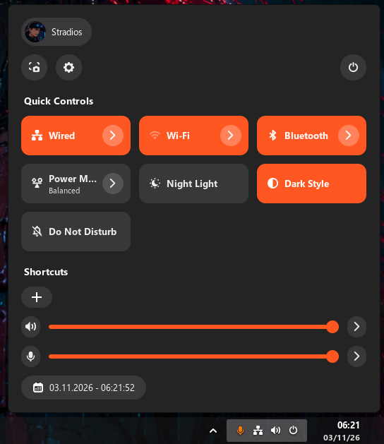
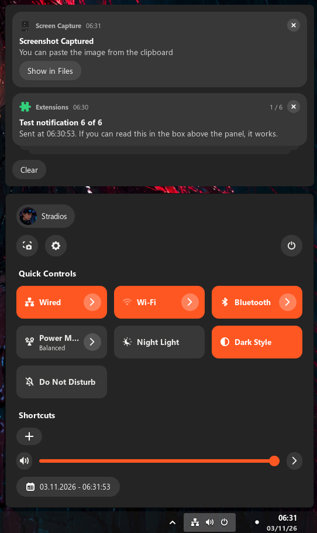
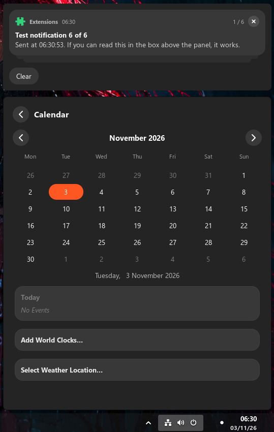

# 4ever Quick Panel
[](https://ko-fi.com/M8K423K344)

A small add-on for GNOME Shell that gives the quick settings panel (network, volume, brightness and the other
tiles) a rounder, accent-colored look, and lets you hide the tiles and sliders you never use.
It is a separate extension from [4ever](https://github.com/Stradios/4ever-extension) on purpose: if a GNOME update
ever breaks it, the panel simply goes back to GNOME's own look and your taskbar keeps working.

> **AI disclaimer:** This extension was created with the help of Claude, an AI assistant made by Anthropic.
> The design, testing and direction are by the repository owner. Review the code before relying on it.

<p align="center">
  
  
  
</p>

Works with GNOME Shell 50 and 51. It is not tied to 4ever and also works on its own.

## Features

- A panel shaped like the dahliaOS / ChromeOS one: three rounded tiles per row, a round arrow button inside
  each tile, **Quick Controls** and **Shortcuts** headings.
- Adapts its size to the screen: the width follows the screen width and the text size setting, so it looks right
  at 1920x1080, 1920x1200, 1280x720 and on scaled laptop screens. Width and tile height can also be set by hand.
- Tiles fill with an accent color when on (orange by default, with a color palette and a custom color picker).
  Separate corner radius for the panel and for the tiles.
- A Shortcuts row with your own buttons (an app, a command or a web address) and a "+" button that opens the
  settings. Add apps from a list of what is installed.
- A calendar page inside the panel: click the date at the bottom. Month navigation, today highlighted in the
  accent color, week start of your choice. GNOME's own calendar popup is not used.
- The calendar page also shows GNOME's own events, world clocks and weather (add them from the page).
  Clicking the date and time on the taskbar opens this calendar instead of GNOME's popup.
- Notifications appear in a separate box above the panel, only while you have any, and it grows upward.
- Pages inside the panel: a tile's arrow (Wi-Fi, Bluetooth, wired network, ...) slides in a page with a back
  button instead of a card under the tiles. Can be switched off.
- Friendly names in the Tiles list (for example "Mobile data" instead of "NMModem Toggle"). Items GNOME is not
  showing right now are greyed.
- Follows the system light or dark style, adjustable opacity.
- Switches to hide any tile or slider.
- Optional name and picture at the top.
- If anything goes wrong while loading, it undoes its changes and leaves GNOME's panel alone.

## What's new in 0.2

Panel shape and automatic size, tile radius and height, headings, Shortcuts row, in-panel calendar
with events, world clocks and weather, in-panel pages for tile arrows, a notification box above the panel,
the taskbar clock opening the panel's calendar, friendly tile names.
This version reaches into more of GNOME's private panel code than 0.1. If something looks wrong on your
system, the settings have switches for pages, headings, shortcuts and the number of columns.

## Install

```sh
./build.sh
gnome-extensions install --force 4ever-quick-panel.zip
```

Log out and back in (on Wayland, new extensions load at login), then enable it:

```sh
gnome-extensions enable 4ever-quick-panel@4ever-quick-panel.stradios
```

Open the settings from the extension manager.

## Upcoming

- A theme page with accent swatches inside the panel.
- More page types (for example sound output and input choices).

These are plans, not promises.

## Troubleshooting

The add-on writes two small text files you can send with a bug report:

- `~/.cache/4ever-quick-panel/debug.txt`: what the panel looks like inside (written the first time you open it after login).
- `~/.cache/4ever-quick-panel/errors.txt`: anything that went wrong.

Settings, Layout has buttons that send test notifications. If something looks wrong, the switches for pages,
headings, shortcuts, the notifications box and the clock takeover turn each feature off on its own.

## Notes

- The panel is part of GNOME Shell's own code and is not a stable interface. This add-on checks what it finds
  before changing anything.
- Hiding a tile only hides it. The service behind it keeps running.

## License

GPL-3.0-or-later. See [LICENSE](LICENSE).
